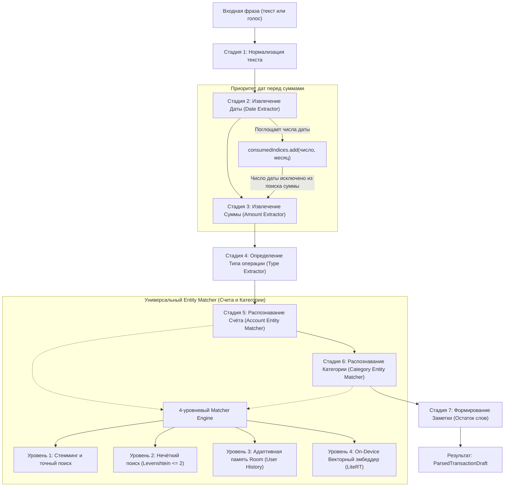
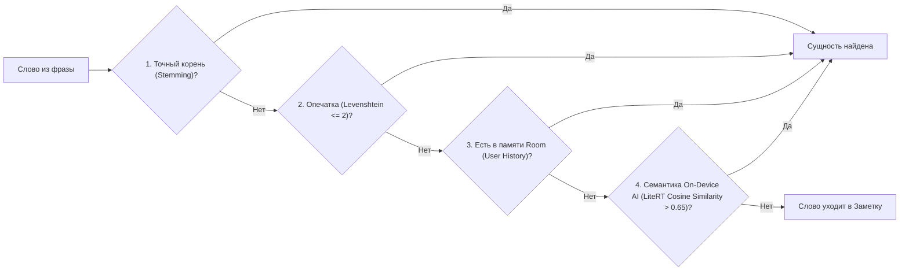

# Архитектура интеллектуального быстрого ввода (NLP & On-Device AI)

## 1. Контекст и проблемы текущей реализации

Текущий парсер (`FastTransactionParser.kt`) основан на линейном переборе токенов с примитивным стеммингом (`RussianStemmer.kt`) и захардкоженными статическими словарями. Это порождает критические дефекты:

1. **Коллизия дат и сумм**:
   - При фразе *«24 октября продукты 1500»* парсер первым находит число `24` и ошибочно назначает его суммой (`amount = 24.0`), а `1500` отправляет в заметку.
   - Поддерживаются только 3 жестких слова: *«сегодня»*, *«вчера»*, *«позавчера»*. Полностью отсутствуют конструкции с месяцами (*«24 октября»*, *«15 мая»*), днями недели (*«в прошлую среду»*, *«в пятницу»*) и форматами дат (*«24.10»*).
2. **Тупик масштабирования счетов и банков**:
   - Захардкожен сленг только трёх сущностей: нал, тинькофф, сбербанк.
   - Реальные счета пользователей (*«Совкомбанк» / «Совок»*, *«Халва»*, *«Райффайзен» / «Райф»*, *«Озон»*, *«ВТБ»*, *«Копилка на отпуск»*) не распознаются по сленгу и синонимам.
3. **Беспомощность перед новыми категориями**:
   - При добавлении пользователем своей категории (*«Спорт»*, *«Хобби»*, *«Питомцы»*, *«Ремонт»*) парсер не связывает её с покупками (*«абонемент»*, *«качалка»*, *«пряжа»*, *«корм»*, *«перфоратор»*).
4. **Неустойчивость к опечаткам**:
   - Любая опечатка пользователя или огрех распознавания речи Google STT (*«прадукты»*, *«шавуза»*) ломает стемминг и поиск.

---

## 2. Архитектура сквозного пайплайна обработки

Обработка текста строится по принципу **многостадийного конвейера (Pipeline)** с фиксацией поглощённых токенов (`consumedIndices`), чтобы исключить взаимное влияние дат, сумм, счетов и категорий:



---

## 3. Детальный разбор стадий пайплайна

### Стадия 1: Нормализация текста
- Приведение к нижнему регистру, замена `ё` на `е`.
- Склейка разделителей тысяч (`20.000` -> `20000`, `1 500` -> `1500`) без повреждения копеек (`150.50`).
- Склейка сокращений: `1.5 к` -> `1.5к`, `2 тыс` -> `2тыс`.

### Стадия 2: Извлечение Даты (Date Extractor)
> **Критическое правило архитектуры**: Извлечение даты происходит **СТРОГО ДО** поиска суммы. Это гарантирует, что число месяца (например, `24`) поглощается датой и никогда не попадёт в сумму транзакции.

Поддерживаемые паттерны (в порядке приоритета):
1. **Календарная дата (Число + Месяц)**:
   - Регулярное выражение: `\b([1-3]?[0-9])\s+(январ[яе]|феврал[яе]|март[ае]|апрел[яе]|ма[яе]|июн[яе]|июл[яе]|август[ае]|сентябр[яе]|октябр[яе]|ноябр[яе]|декабр[яе])(?:\s+(\d{4}))?\b`
   - Примеры: *«24 октября»*, *«1 января»*, *«15 мая 2024»*.
   - Токены числа и месяца помечаются как использованные в `consumedIndices`.
2. **Числовые форматы**:
   - Паттерн `\b(0?[1-9]|[12][0-9]|3[01])[./](0?[1-9]|1[012])(?:[./](\d{2,4}))?\b`.
   - Примеры: *«24.10»*, *«05/11/2024»*.
3. **Относительные текстовые дни**:
   - *«сегодня»* (текущий timestamp).
   - *«вчера»* (`Calendar.DAY_OF_YEAR - 1`).
   - *«позавчера»* (`Calendar.DAY_OF_YEAR - 2`).
   - *«N дней/дня назад»* (`Calendar.DAY_OF_YEAR - N`).
4. **Дни недели**:
   - Паттерн: `\b(?:в|во)?\s*(прошл[уюыйе]+|этот|эту)?\s*(понедельник|вторник|сред[уа]|четверг|пятниц[уа]|суббот[уа]|воскресенье)\b`.
   - Примеры: *«в прошлую среду»*, *«в пятницу»*. Вычисляется смещение назад от текущего дня недели.

### Стадия 3: Извлечение Суммы (Amount Extractor)
Работает только по оставшимся непоглощённым токенам (`index !in consumedIndices`):
1. **Приоритет явной валюты**: число с прикреплённым маркером валюты (`1500р`, `500руб`, `1000₽`).
2. **Приоритет стоимостного предлога**: число, перед которым стоит предлог `за`, `на`, `по` (*«за 1500»*, *«на 800»*).
3. **Словесные числительные**: *«полторы»* (`1500.0`), *«пятьсот»* (`500.0`).
4. **Обычное число**: первое оставшееся числовое значение.
5. Найденный токен добавляется в `consumedIndices`.

### Стадия 4: Определение Типа операции (Type Extractor)
- Проверка маркеров перевода (*«перевод»*, *«перевел»*, *«перекинул»*) -> `TransactionType.TRANSFER`.
- Проверка маркеров дохода (*«зарплата»*, *«аванс»*, *«кешбэк»*, *«стипендия»*, *«подарок»*, *«доход»*) -> `TransactionType.INCOME`.
- По умолчанию: `TransactionType.EXPENSE`.

---

## 4. Единый Entity Matcher для Счетов и Категорий

Для счетов (банков) и категорий применяется **одинаковый четырёхуровневый алгоритм разрешения сущностей (Entity Resolution Engine)**:



### Уровень 1: Стемминг и прямое совпадение корней
- Отсекает окончания существительных/прилагательных через стеммер.
- Совпадение по корню названия сущности (*«сбербанком»* -> `сбербанк`, *«продуктовый»* -> `продукт`).
- Время выполнения: **< 0.05 мс**.

### Уровень 2: Нечёткий поиск опечаток (Damerau-Levenshtein Distance)
- Исправляет опечатки пользователя и ошибки распознавания Google STT.
- Порог: расстояние редактирования $\le 1$ для коротких слов (4–6 букв), $\le 2$ для длинных слов (> 6 букв).
- Примеры: *«савкомбанк»* -> *«совкомбанк»*, *«прадукты»* -> *«продукты»*, *«тинькоф»* -> *«тинькофф»*.
- Время выполнения: **< 0.1 мс**.

### Уровень 3: Адаптивная память в Room (Самообучение пользователя)
Приложение учится на подтверждённых действиях конкретного пользователя без нейросетей.

Таблицы в Room:
```sql
-- Связка слов со счетами пользователя
CREATE TABLE account_aliases (
    alias_stem TEXT NOT NULL,
    account_id TEXT NOT NULL,
    usage_count INTEGER NOT NULL DEFAULT 1,
    PRIMARY KEY (alias_stem, account_id),
    FOREIGN KEY (account_id) REFERENCES accounts(id) ON DELETE CASCADE
);

-- Связка слов с категориями пользователя
CREATE TABLE category_keywords (
    keyword_stem TEXT NOT NULL,
    category_id TEXT NOT NULL,
    usage_count INTEGER NOT NULL DEFAULT 1,
    PRIMARY KEY (keyword_stem, category_id),
    FOREIGN KEY (category_id) REFERENCES categories(id) ON DELETE CASCADE
);
```

#### Как и когда происходит запоминание (Feedback Loop):

1. **Случай 1: Уровень 4 не был уверен (`similarity < 0.65`)**:
   - Пользователь сказал редкое слово или сленг (*«закинул на совок 500»* или *«купил жижу 400»*).
   - Уровни 1 и 2 не нашли совпадений. Уровень 3 пуст.
   - Уровень 4 (AI): у слова *«совок»* близость к банковским счетам слишком низкая (`similarity = 0.22`), порог 0.65 не пройден.
   - AI честно признаёт: *«Я не знаю этот счёт»*. Поле остаётся пустым (или по умолчанию).
   - Пользователь в открывшейся шторке руками выбирает счёт *«Совкомбанк»*.
   - **В момент нажатия «Готово»**: приложение связывает стем `совок` -> `account_id (Совкомбанк)` в таблице `account_aliases`.
   - В следующий раз слово *«совок»* распознаётся мгновенно на **Уровне 3 за 0.1 мс**.

2. **Случай 2: Уровень 4 ошибся (Пользователь переопределил категорию/счёт)**:
   - Пользователь сказал: *«купил мыло 150»*.
   - Уровень 4 предсказал категорию *«Здоровье/Аптека»*.
   - Но для пользователя это категория *«Бытовая химия/Дом»*. Пользователь в шторке переключает категорию руками.
   - **В момент нажатия «Готово»**: связка `мыл` -> `category_id (Бытовая химия)` записывается в Room.
   - **Приоритет**: Уровень 3 проверяется **ДО** Уровня 4. Теперь выбор пользователя навсегда перекрывает предположение AI.

### Уровень 4: On-Device Векторный эмбеддер (LiteRT / TFLite)
Срабатывает только для новых, ранее неизвестных слов (когда уровни 1–3 не дали совпадения).

1. **Векторизация сущностей**:
   - При создании/обновлении категории или счёта приложение вычисляет 128-мерный вектор FloatArray и кэширует его в Room (`categories.embedding`, `accounts.embedding`).
2. **Векторизация запроса**:
   - Неопознанное слово (например, *«абонемент»*, *«перфоратор»*, *«вискас»*) за 5–10 мс превращается моделью в вектор `queryVector`.
3. **Косинусное сравнение**:
   - Вычисляется Cosine Similarity со всеми категориями и счетами.
   - Порог уверенности: `similarity >= 0.65`. Если ни одна категория не набрала 0.65, поле не предзаполняется ошибочно, а остаётся для выбора пользователю.
   - *«абонемент»* -> категория *«Спорт»* (`sim = 0.82`).
   - *«акции»* -> счёт *«Брокер»* (`sim = 0.79`).

---

## 5. Стадия 7: Интеллектуальное формирование Заметки (Smart Note Retention)

В старом парсере любое слово, по которому определилась категория, безвозвратно удалялось из фразы. В результате фраза *«Такси 500»* давала категорию *«Транспорт»*, но поле заметки оставалось **абсолютно пустым**. Пользователь терял информацию о том, на что конкретно ушли деньги (*«Такси»*, *«Бензин»* или *«Метро»*).

### Новые правила формирования заметки:

1. **Что БЕЗУСЛОВНО удаляется из заметки**:
   - Токены суммы и валюты (`500`, `1500р`, `к`, `тыс`, `рублей`);
   - Токены дат (`вчера`, `24 октября`, `в прошлую среду`, `позавчера`);
   - Токены счёта (`с тинька`, `с карты`, `наличка`);
   - Служебные предлоги перед ними (`в`, `на`, `с`, `со`, `по`, `за`);
   - **Дословное имя категории**, если оно в точности повторяет название категории (например, если категория называется *«Транспорт»*, и пользователь сказал *«Транспорт 500»* — слово *«Транспорт»* в заметку не дублируется).
2. **Что ОБЯЗАТЕЛЬНО сохраняется в заметку**:
   - **Слова-мерчанты, синонимы и конкретные товары**: если категория определилась косвенно (через синоним, базу Room или эмбеддер), исходное слово пользователя **сохраняется в заметку**.
   - Все остальные поясняющие слова.

#### Примеры работы:

| Входная фраза | Категория | Счёт | Дата | Сумма | **Итоговая заметка** |
| :--- | :--- | :--- | :--- | :--- | :--- |
| *«Такси 500 вчера с карты»* | Транспорт | Карта | вчера | 500 ₽ | **«Такси»** *(не теряется!)* |
| *«Пятёрочка сыр и кофе 1200»* | Продукты | Дефолтный | сегодня | 1200 ₽ | **«Пятёрочка сыр и кофе»** |
| *«Вкусвилл 850»* | Продукты | Дефолтный | сегодня | 850 ₽ | **«Вкусвилл»** |
| *«Бензин лукойл 2500 с совка»* | Транспорт | Совкомбанк | сегодня | 2500 ₽ | **«Бензин лукойл»** |
| *«Транспорт 60»* | Транспорт | Дефолтный | сегодня | 60 ₽ | *пусто (дословное совпадение)* |

---

## 6. План поэтапного внедрения

| Фаза | Что реализуется | Зависимости | Влияние на APK |
| :--- | :--- | :--- | :--- |
| **Фаза 1: Алгоритмический пайплайн** | Переработка парсера на фазы (Дата -> Сумма -> Счёт -> Категория). Парсинг дат (число+месяц, дни недели). Нечёткий поиск Левенштейна. | Чистый Kotlin | **+0 МБ** |
| **Фаза 2: Адаптивная память Room** | Миграция БД (таблицы `account_aliases`, `category_keywords`). Запись ассоциаций при создании транзакций. Обучение на истории. | Room | **+0 МБ** |
| **Фаза 3: On-Device Векторный AI** | Подключение LiteRT Text Embedder + квантованная модель (8–12 МБ). Вычисление эмбеддингов при создании счетов/категорий. | LiteRT / TFLite | **+10–12 МБ** |
